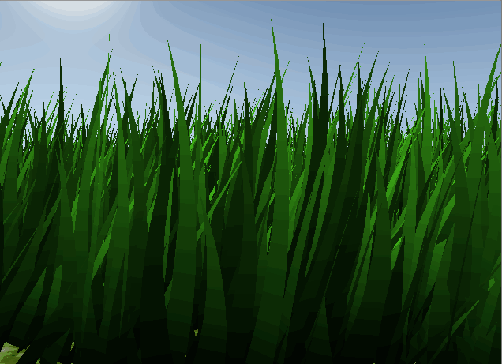
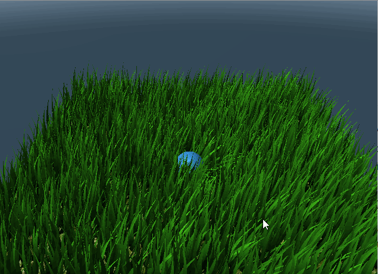
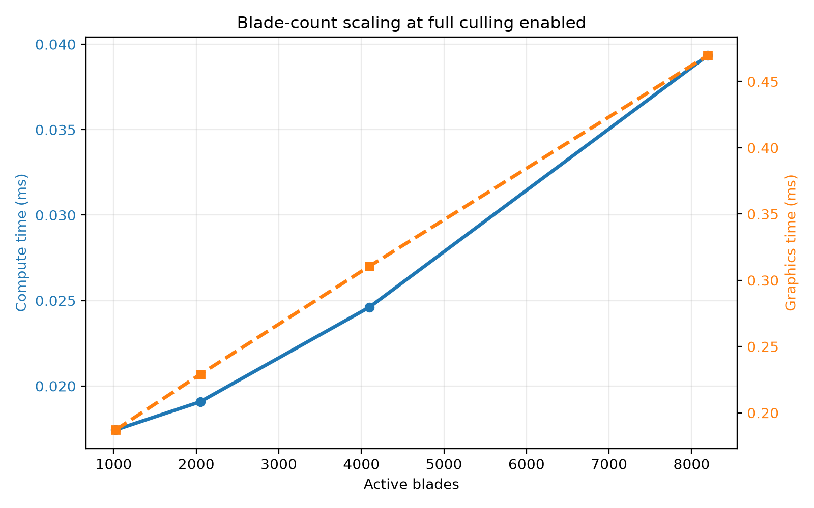
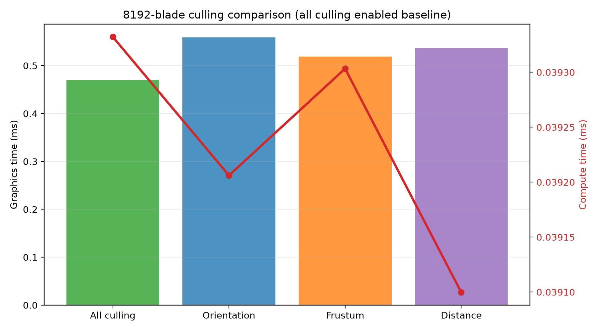

Vulkan Grass Rendering
==================================

**University of Pennsylvania, CIS 565: GPU Programming and Architecture, Project 5**

* Sau Lok Li
* Tested on: Windows, AMD Ryzen 9 270 w/ Radeon 780M Graphics, NVIDIA GeForce RTX 5070 Laptop GPU (8151 MiB), driver 596.13

This project implements a real-time Vulkan grass renderer inspired by responsive real-time grass simulation. I built a GPU-driven Bezier grass system that simulates blade motion, responds to wind and object collisions, and culls blades aggressively to keep the render fast even at high blade counts.

### Features implemented

- GPU simulation of grass blades as Bezier curves with damping, gravity, and wind-driven motion
- Real-time interaction with a draggable sphere that pushes nearby blades aside and lets them bounce back
- Tessellated grass rendering using a Vulkan graphics pipeline with shading, color variation, and lighting
- Three culling tests: orientation, frustum, and distance-based culling for performance pruning
- Dynamic blade-count controls (1,024, 2,048, 4,096, and 8,192 active blades)
- Timestamp-based GPU timing capture for compute and graphics pipeline analysis

### Without culling

### With culling

### Interactive controls

- Click and drag the textured blue sphere to move it across the grass; nearby blades flatten and bend away from its footprint. Release to let gravity drop it and bounce it on the ground. Drag with the left mouse button elsewhere to orbit the camera, use the mouse scroll wheel to zoom, and drag with the right mouse button to pan.
- Press **W**/**S** to increase/decrease wind strength.
- Press **A**/**D** to rotate the wind direction.
- Press **R** to restore the default wind.
- Use the **arrow keys** to nudge the blue sphere. Nearby blades are pushed aside by the sphere and its motion.
- Press **1/2/3/4** to use 1,024/2,048/4,096/8,192 active blades. Toggle orientation, frustum, and distance culling with **F1/F2/F3**; all three start enabled.
- Press **P** to start or stop GPU timing capture. Samples are written to `performance.csv` in the process working directory.

## Performance analysis

The renderer records GPU compute and graphics durations using Vulkan timestamp queries. Start a capture with **P**, let the scene settle, run one configuration at a time, and stop the capture with **P**. `performance.csv` contains one row per completed frame with the active blade count, each enabled culling test (`1` enabled, `0` disabled), and compute/graphics time in milliseconds. Compute time covers grass simulation and culling; graphics time covers the render pass. Timestamps are omitted on devices whose graphics or compute queues do not support them; the app reports this when capture is requested.

Use the following comparisons to evaluate blade-count scaling and isolate culling effects:

| Comparison | Blade-count keys | Culling state |
|---|---|---|
| Blade-count scaling | 1, 2, 3, then 4 | Leave F1/F2/F3 enabled |
| Orientation culling | 4 | All disabled, then enable F1 only |
| Frustum culling | 4 | All disabled, then enable F2 only |
| Distance/LOD culling | 4 | All disabled, then enable F3 only |

For each configuration, keep the camera and wind fixed, wait briefly after changing settings, discard transition/warm-up rows, and compare the mean compute and graphics times over a similarly sized group of steady-state rows. Compare each single-test culling run against the all-disabled run at the same blade count. The CSV captures timings from the current machine; no hardware-specific performance values are claimed here.

### Measured performance results

The steady-state averages from the captured CSVs show a predictable increase in both compute and graphics cost as the active blade count grows. In the 1,024-to-8,192 blade range, the renderer stays very fast overall, but the cost scales upward as more blades need to be simulated and rasterized.

Blade-count results below are mean GPU times in milliseconds, with orientation, frustum, and distance culling enabled:

| Active blades | Compute (ms) | Graphics (ms) |
|---:|---:|---:|
| 1,024 | 0.017 | 0.187 |
| 2,048 | 0.019 | 0.229 |
| 4,096 | 0.025 | 0.311 |
| 8,192 | 0.039 | 0.470 |

Analysis:
- Compute time climbs from about 0.017 ms at 1,024 blades to 0.039 ms at 8,192 blades.
- Graphics time rises from about 0.187 ms to 0.470 ms over the same range.
- The cost is not perfectly linear: increasing blade count by 8x only raises compute by about 2.3x and graphics by about 2.5x, which suggests the GPU is extracting useful parallelism and the fixed overhead is amortized well.
- The render step is still the dominant cost; it is roughly 10x larger than the compute simulation cost at the highest blade count, so the bottleneck is increasingly in fragment processing and rasterization rather than the grass simulation itself.

The culling study at 8,192 blades emphasizes how much the per-frame work depends on the number of blades that survive each stage of rejection. The all-culling-enabled configuration remains the fastest full setup in the captured data, while enabling only one test at a time increases the graphics cost noticeably.

Culling results are mean GPU times in milliseconds. The all-enabled baseline comes from the 8,192-blade run in `performance_blade_count.csv`; the individual-test measurements come from `performance_culling.csv`.

| Culling configuration | Compute (ms) | Graphics (ms) | Graphics change vs. all enabled |
|---|---:|---:|---:|
| All three enabled (baseline) | 0.039 | 0.470 | — |
| Orientation only | 0.039 | 0.559 | +19.0% |
| Frustum only | 0.039 | 0.519 | +10.5% |
| Distance only | 0.039 | 0.537 | +14.3% |

Analysis:
- The all-culling-enabled 8,192-blade baseline sits at about 0.039 ms compute and 0.470 ms graphics.
- Orientation-only culling is the slowest of the single-test configurations at about 0.559 ms graphics, which is roughly 19% higher than the all-culling baseline.
- Frustum-only culling is about 0.519 ms graphics, about 10% slower than the all-culling baseline.
- Distance-only culling is about 0.537 ms graphics, about 14% slower than the all-culling baseline.
- The compute time stays nearly constant across all three culling modes (~0.039-0.040 ms), indicating that culling overhead itself is small relative to the rendering workload. The real gain comes from pruning more blades before they reach expensive rasterization work.
- In other words, the tests are complementary — the renderer benefits most when culling is combined rather than toggled individually.

Grass blades use per-blade color variation, root-to-tip shading, ambient and diffuse lighting, backlighting, and a subtle specular highlight.

The background uses a camera-oriented procedural sky with a blue zenith, atmospheric horizon haze, and a soft sun glow.

## Credits

This project builds on the CIS 565 Vulkan starter framework and course materials. The grass representation, simulation, and culling are informed by [Responsive Real-Time Grass Rendering for General 3D Scenes](https://www.cg.tuwien.ac.at/research/publications/2017/JAHRMANN-2017-RRTG/JAHRMANN-2017-RRTG-draft.pdf). The project uses [GLFW](https://github.com/glfw/glfw), [GLM](https://github.com/g-truc/glm), and [stb](https://github.com/nothings/stb).