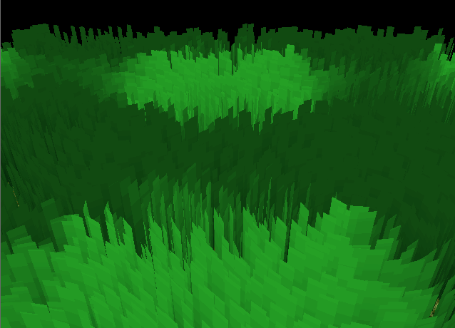
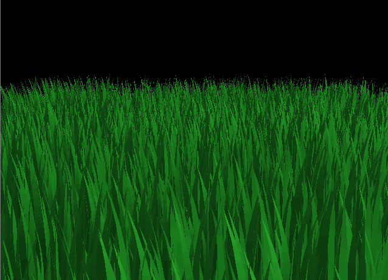
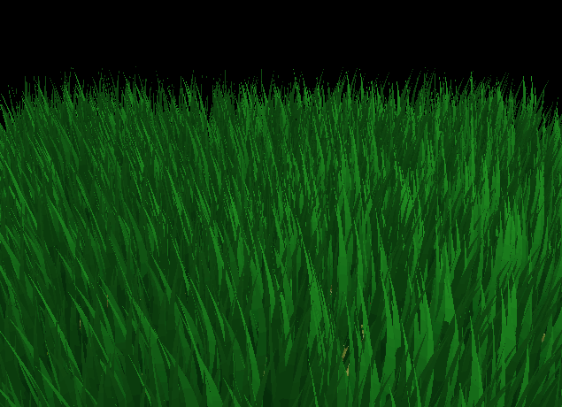

Vulkan Grass Rendering
==================================

**University of Pennsylvania, CIS 565: GPU Programming and Architecture, Project 5**

* Sau Lok Li
* Tested on: Windows, AMD Ryzen 9 270 w/ Radeon 780M Graphics, NVIDIA GeForce RTX 5070 Laptop GPU (8151 MiB), driver 596.13

### (TODO: Your README)

*DO NOT* leave the README to the last minute! It is a crucial part of the
project, and we will not be able to grade you without a good README.

### With culling

### Interactive controls

- Click and drag the textured blue sphere to move it across the grass; nearby blades flatten and bend away from its footprint. Release to let gravity drop it and bounce it on the ground. Drag with the left mouse button elsewhere to orbit the camera; drag with the right mouse button to zoom.
- Press **W**/**S** to increase/decrease wind strength.
- Press **A**/**D** to rotate the wind direction.
- Press **R** to restore the default wind.
- Use the **arrow keys** to nudge the blue sphere. Nearby blades are pushed aside by the sphere and its motion.

Grass blades use per-blade color variation, root-to-tip shading, ambient and diffuse lighting, backlighting, and a subtle specular highlight.

The background uses a camera-oriented procedural sky with a blue zenith, atmospheric horizon haze, and a soft sun glow.